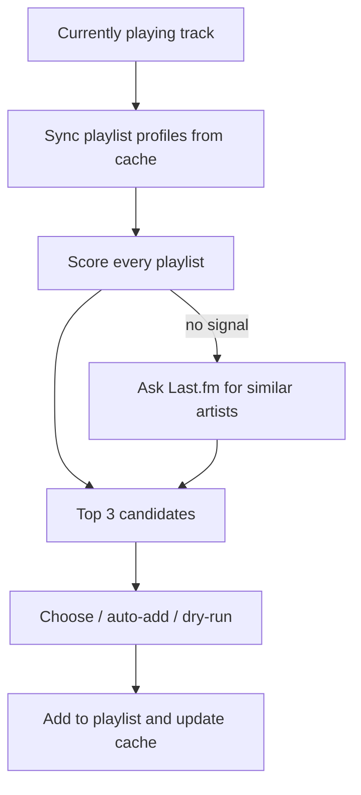
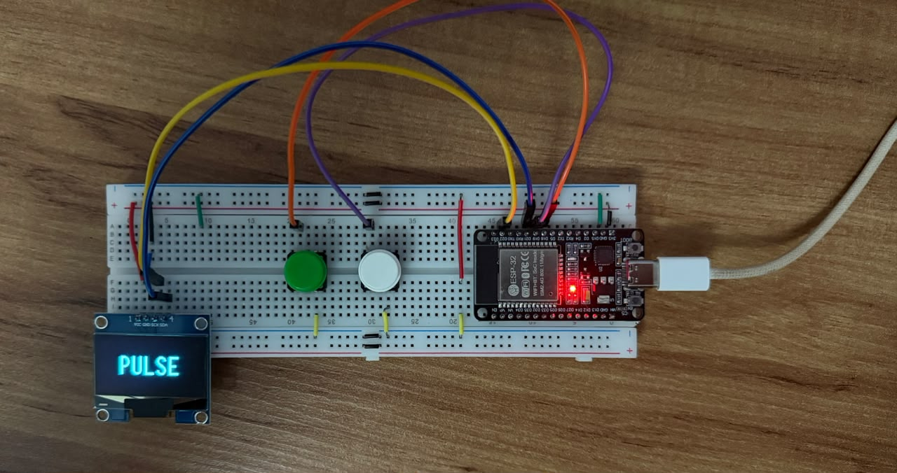

# Pulse

[](https://github.com/alberthamoui/pulse/actions/workflows/ci.yml)


Pulse looks at the song currently playing on Spotify and adds it to the playlist where it fits best. It runs as a Python CLI and as a standalone ESP32 device with two buttons and an OLED screen.

I have around 50 playlists, and every time I heard something I liked I had to stop and think about where it should go. Pulse does that part for me: it builds a profile of each playlist from the artists in it, scores the current track against all of them and suggests the top 3.

There's no trained model here. Each playlist is treated like a document and each artist like a word, and the ranking uses TF-IDF plus a co-occurrence signal between artists. So the suggestions come entirely from how I already organize my own music.

## How it works



**Playlist profiles.** For each playlist I count how many times each artist shows up and turn that into a smoothed frequency:

```
tf(artist, playlist) = (count + 1) / (tracks + V)      V = distinct artists in the playlist
```

Without the smoothing, small playlists won: one artist in a 3-song playlist gets 0.33 and beats everything else.

**Artist weight.** An artist that's in every playlist doesn't help decide anything, so each artist gets an IDF:

```
idf(artist) = log(N / df)      N = number of playlists, df = playlists with that artist
```

**Scoring.** For the artist X of the current track, each playlist p gets:

```
direct   = tf(X, p) * idf(X)
indirect = sum over other artists Y in p of  jaccard(X, Y) * tf(Y, p) * idf(Y)
score    = 0.8 * (direct + 0.5 * indirect) + 0.2 * genre_overlap
```

`jaccard(X, Y)` measures how often X and Y end up in the same playlists. This is what makes a new song from an artist I rarely add still land next to the artists I usually group with them. The weights live in `config/constants.py`.

**Unknown artists.** If nothing scores above zero, Pulse asks Last.fm for similar artists, finds the ones already in my library and scores the playlists through them. If that also fails, the song goes to a fallback playlist so nothing gets lost.

**Cache.** Reading every playlist takes about 100 API calls, so profiles are cached and a playlist is only re-read when its Spotify `snapshot_id` changes. A normal run ends up using around 5 calls. When playlists do need rebuilding, they're fetched in parallel.

There's a longer write-up of the internals (in Portuguese) in [docs/ARCHITECTURE.md](docs/ARCHITECTURE.md).

## ESP32 device



The same idea without a computer: an ESP32 with a 1.3" OLED and two buttons. Press one while something plays on Spotify (on any device), scroll through the suggested playlists and confirm.

- Written in C++ with PlatformIO and the Arduino framework; talks to the Spotify Web API and Last.fm directly over HTTPS with embedded root CAs.
- Playlist profiles live on the ESP32's flash (LittleFS) and are only re-read when a playlist's `snapshot_id` changes, so a normal boot takes about 10 s.
- JSON responses are parsed as a stream with filters, so large responses never sit in RAM.
- Ranks playlists by artist frequency and falls back to Last.fm similar artists for unknown artists, like the Python version.

[Wiring](firmware/README.md#hardware), setup and the problems solved along the way (heap fragmentation during TLS, a shadowed stream timeout, safe retries) are in [firmware/README.md](firmware/README.md).

## Setup

You need Python 3.10+ and a Spotify app from the [developer dashboard](https://developer.spotify.com/dashboard). A [Last.fm API key](https://www.last.fm/api/account/create) is optional and only used for unknown artists.

```bash
git clone https://github.com/alberthamoui/pulse.git
cd pulse
python -m venv .venv
source .venv/bin/activate      # on Windows: .venv\Scripts\activate
pip install -r requirements.txt

cp config/settings.example.py config/settings.py
cp config/config.example.json config/config.json
```

Then:

1. Add `http://127.0.0.1:8080` as a Redirect URI in your Spotify app settings.
2. Put your client ID and secret (and the Last.fm key, if you have one) in `config/settings.py`.
3. Create an empty playlist for songs that don't match anything and put its ID in `fallback_playlist_id` in `config/config.json`.

Both files are in `.gitignore`.

Other options in `config.json`:

- `algorithm`: `hybrid` (the one described above) or `artist_frequency` (simpler baseline, just artist frequency)
- `cache_file`: where the profiles are saved, `.pulse_cache.json` by default
- `auto_add_min_score`: minimum score for `--auto` to add without asking

## Usage

Play something on Spotify and run:

```bash
python main.py                  # shows the top 3 and asks where to add
python main.py --auto           # adds to the best match if it passes the minimum score
python main.py --dry-run        # only shows the ranking
python main.py --refresh        # rebuilds all profiles before running
python main.py --cache-refresh  # only rebuilds the cache
```

The first run opens the browser to log in to Spotify and reads all your playlists, so it takes a bit longer. If the song is already in one of your playlists, Pulse warns you before adding it again.

## Tests

The scoring is covered by unit tests that use fake profiles and never touch the network:

```bash
pip install -r requirements-dev.txt
pytest
```

CI runs them on Python 3.10 and 3.12 and also builds both firmware environments.

## Limitations

- Spotify returns 403 on the artist genres endpoint for apps without extended access, so `genre_overlap` is always 0 right now and the ranking is based only on artists.
- The co-occurrence signal only works for artists that are already in at least one playlist.
- Only the main artist of a track is scored. Featured artists are already read from the API but not used yet.
- The ESP32 uses a simpler direct ranking (artist frequency, no TF-IDF or co-occurrence) to keep matching to a single pass over flash.

## Next steps

- Bring TF-IDF and co-occurrence to the ESP32 ranking.
- Normalize the score so the `--auto` threshold actually means something.
- Use featured artists in the scoring.
- Learn from my choices when I pick a different playlist than the suggested one.

## License

MIT
