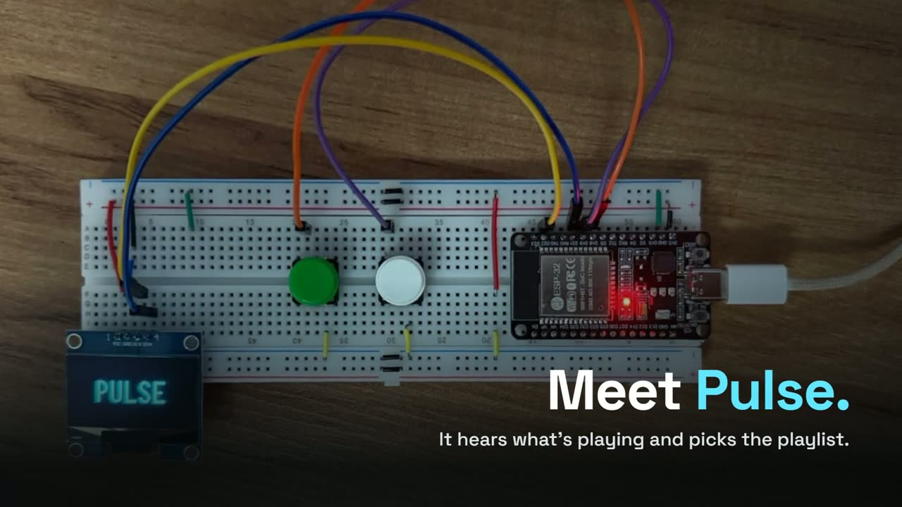
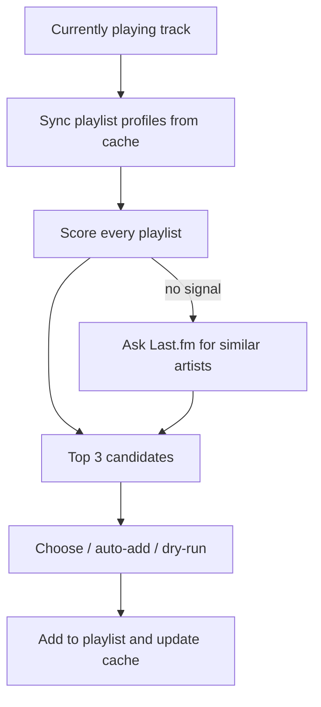

# Pulse

[](https://github.com/alberthamoui/pulse/actions/workflows/ci.yml)


**Hear a song you like, press a button, and Pulse finds the playlist where it belongs.**

[](docs/demo.mp4)

▶ [Watch the 21-second demo](docs/demo.mp4). It's an animation: the device screens are drawn with the firmware's own fonts and layout, the terminal shows the CLI's real output format, and the playlists are examples.

I have around 50 playlists. Every time something good came on, I had to stop, remember what each playlist was about and decide where the song went.

Pulse does that thinking for me. It looks at the song playing on Spotify, compares it with every playlist I've already built and suggests the 3 where it fits best. It runs as a Python CLI and as a standalone ESP32 gadget with two buttons and a small OLED screen, which talks to Spotify on its own: once it's set up, there's no computer, server or phone app involved. When the first suggestion is right, that's two button presses.

## Why it's interesting

- **No model, no training data.** Each playlist is treated like a document and each artist like a word. The ranking is TF-IDF plus a co-occurrence signal between artists, so the suggestions come entirely from how you already organize your music, and it works from the first run.
- **It places artists you rarely add.** If an artist shows up in only one or two of your playlists, the co-occurrence signal still puts the song next to the artists you usually group them with.
- **It handles artists you've never added.** When an artist isn't in any playlist, Pulse asks Last.fm for similar artists, finds the ones you already have and ranks your playlists through them. If even that fails, the song goes to a fallback playlist instead of being lost.
- **About 5 API calls per run.** Reading all my playlists takes around 100 calls, so profiles are cached and a playlist is only re-read when its Spotify `snapshot_id` changes.
- **Same idea, two very different machines.** The Python version has the full ranking. The firmware does the whole thing in C++ on a microcontroller with a few hundred kilobytes of RAM: HTTPS, OAuth token refresh, pagination over thousands of tracks and the ranking, from flash.

## The device


An ESP32 DevKit, a 1.3" OLED and two buttons on a breadboard. Press a button while anything plays on Spotify, on any device. The screen shows the song, the artist and up to 5 playlists, with the share of that artist in each one and a mark on the playlists that already have the song. Scroll with one button, confirm with the other.

Fitting this into an ESP32 was the fun part:

- **Large responses never sit in RAM.** JSON is parsed straight from the TLS socket through ArduinoJson filters: a 40 KB Last.fm response becomes a few hundred bytes.
- **A heap fragmentation bug, found and fixed.** Reading my largest playlist (640 tracks) left 100 KB of heap free but no block bigger than 43 KB, and the TLS handshake for the next page failed. Track IDs are now streamed to flash during the sync.
- **A timeout hidden by C++ name shadowing.** `WiFiClientSecure` declares its own `_timeout`, which hides the one in `Stream`, so the HTTP timeout never reached the JSON parser and large responses were cut after 1 s.
- **The client secret never touches the device.** Tokens are refreshed with PKCE, the bearer token is only ever sent to `api.spotify.com`, and HTTPS is verified against embedded root CAs instead of `setInsecure()`.
- **Retries that can't duplicate a song.** Failed `GET`s are retried; a `POST` that times out is not, because it may already have added the song.
- **Writes that survive a power cut.** Playlist profiles and the rotating refresh token are written to a temp file and then renamed, so a power cut mid-write doesn't leave a half-written file.

The first sync reads about 3,200 tracks in roughly 2.5 minutes. After that, a boot only re-reads what changed and takes about 10 s. Wiring, setup and the details are in [firmware/README.md](firmware/README.md).

## How it works



**Playlist profiles.** For each playlist I count how many times each artist shows up and turn that into a smoothed frequency:

```
tf(artist, playlist) = (count + 1) / (tracks + V)      V = distinct artists in the playlist
```

Without the smoothing, small playlists won: one artist in a 3-song playlist gets 0.33 and beats everything else.

**Artist weight.** An artist that's in every playlist doesn't help decide anything, so each artist gets an IDF:

```
idf(artist) = log(N / df)      N = number of playlists, df = playlists with that artist
```

**Scoring.** For the artist X of the current track, each playlist p gets:

```
direct   = tf(X, p) * idf(X)
indirect = sum over other artists Y in p of  jaccard(X, Y) * tf(Y, p) * idf(Y)
score    = direct + 0.5 * indirect
```

`jaccard(X, Y)` measures how often X and Y end up in the same playlists. This is what makes a new song from an artist I rarely add still land next to the artists I usually group with them. The 0.5 lives in `src/core/constants.py`.

**Unknown artists.** If nothing scores above zero, Pulse asks Last.fm for similar artists, finds the ones already in my library and scores the playlists through them. If that also fails, the song goes to a fallback playlist so nothing gets lost.

**Which playlists.** Playlists you own and collaborative playlists you follow; playlists you only follow are ignored.

**Cache.** Profiles are cached and only rebuilt when a playlist's `snapshot_id` changes; the ones that do need rebuilding are fetched in parallel. A playlist that fails to load (rate limit, network) keeps its old profile and is retried on the next run. After a song is added, the cache is updated locally, with no extra API call.

There's a longer write-up of the internals in [docs/ARCHITECTURE.md](docs/ARCHITECTURE.md).

## Project structure

```
pulse/
├── main.py                      command line: run modes, the playlist menu and adding the song
├── src/core/                    everything main.py uses, one module per job
│   ├── user_config.py           reads config/settings.py and config/config.json; explains what to fix
│   ├── client.py                Spotify API: current song, your playlists, add to a playlist
│   ├── playlist_analyzer.py     reads each playlist and builds its profile (artist counts + track IDs)
│   ├── cache.py                 keeps the profiles in .pulse_cache.json and re-reads only what changed
│   ├── matcher.py               ranks the playlists for a song (TF-IDF + co-occurrence, Last.fm fallback)
│   ├── lastfm_client.py         similar artists from Last.fm
│   ├── models.py                Track, PlaylistProfile, MatchResult
│   └── constants.py             tuning knobs: co-occurrence weight, smoothing, timeouts
├── config/                      your settings.py and config.json (out of git) and their .example templates
├── tests/                       pytest, no network: one test file per module, plus the CLI flow
├── tools/get_refresh_token.py   generates the refresh token the ESP32 uses
├── firmware/                    the ESP32 device (C++/PlatformIO)
│   ├── include/                 config.h (pins, timings, limits) and secrets.h (credentials, out of git)
│   └── src/                     boot, state machine, display, buttons, Spotify client, profiles, Last.fm
└── docs/                        ARCHITECTURE.md (internals in depth) and the photos
```

**One run of the CLI, through the code:**

1. `main.run_pulse` loads your config with `user_config`; anything missing or still a placeholder stops here with a message saying what to fix.
2. `client.get_current_track` asks Spotify for the current song.
3. `cache.sync_profiles` compares each playlist's `snapshot_id` with the cache and sends only the changed ones to `playlist_analyzer`, which reads them in parallel.
4. `matcher.PlaylistMatcher` ranks every playlist for the song's artist; with no match, it tries `lastfm_client`.
5. `main` shows the menu, `client` adds the song, and `cache` records it locally so the next run doesn't re-read that playlist.

**The device** follows the same steps in C++: `main.cpp` connects to Wi-Fi and syncs the profiles at boot, then `state_machine.cpp` reacts to the buttons, asks `spotify_backend.cpp` for the song and the ranking (from the profiles on flash in `profiles.cpp`, or `lastfm.cpp`) and draws each screen with `display.cpp`. The file-by-file layout is in [firmware/README.md](firmware/README.md#layout).

## Setup

You need Python 3.10+ and a Spotify app from the [developer dashboard](https://developer.spotify.com/dashboard). A [Last.fm API key](https://www.last.fm/api/account/create) is optional and only used for unknown artists.

```bash
git clone https://github.com/alberthamoui/pulse.git
cd pulse
python -m venv .venv
source .venv/bin/activate      # on Windows: .venv\Scripts\activate
pip install -r requirements.txt

cp config/settings.example.py config/settings.py
cp config/config.example.json config/config.json
```

Then:

1. In the [developer dashboard](https://developer.spotify.com/dashboard), create an app and tick **Web API**.
2. In the app settings, add the Redirect URIs `http://127.0.0.1:8080` (Python version) and `http://127.0.0.1:8888/callback` (ESP32 token tool). It has to be `127.0.0.1`: Spotify doesn't accept `localhost`.
3. If Pulse will be used with a Spotify account other than the one that created the app, add that account under **User Management** (name and the account's e-mail). New apps are in development mode, which only lets in the owner and the accounts listed there; anyone else gets a 403.
4. Put the client ID and secret (and the Last.fm key, if you have one) in `config/settings.py`.
5. Create an empty playlist for songs that don't match anything, copy its link (Share → Copy link to playlist) and paste it into `fallback_playlist_id` in `config/config.json`. The bare playlist ID also works.

Both files are in `.gitignore`.

Other options in `config.json`:

- `cache_file`: where the profiles are saved, `.pulse_cache.json` by default
- `auto_add_min_score`: minimum score for `--auto` to add without asking

To build the device, see [firmware/README.md](firmware/README.md).

## Usage

Play something on Spotify (playing or paused) and run:

```bash
python main.py                  # shows the suggestions and asks where to add
python main.py --auto           # adds to the best match if it passes the minimum score
python main.py --dry-run        # only shows the ranking
python main.py --refresh        # rebuilds all profiles before running
python main.py --cache-refresh  # only rebuilds the cache
```

The first run opens the browser to log in to Spotify and reads all your playlists, so it takes a bit longer. If the song is already in one of your playlists, Pulse warns you before adding it again.

## Troubleshooting

| What you see | What to do |
|---|---|
| The browser shows `INVALID_CLIENT: Invalid redirect URI` | The Redirect URI in the app settings must be exactly `http://127.0.0.1:8080` (the same as `SPOTIFY_REDIRECT_URI` in `config/settings.py`). |
| `Spotify refused access (403)` | The account you logged in with isn't registered on the app. Add it under User Management in the dashboard (step 3 of Setup). |
| `Nothing playing` while something is playing | Spotify doesn't report the song in a private session, and podcasts and audiobooks aren't songs. Turn off the private session or play a song. |
| `doesn't look like a Spotify playlist` | Paste the full playlist link into `fallback_playlist_id`; links to tracks or albums don't work. |
| Logged in with the wrong account | Delete the `.cache` file in the folder you run Pulse from and run it again to log in. |
| A playlist doesn't show up in the suggestions | Only playlists you own and collaborative ones are considered. If one couldn't be read (rate limit or network), Pulse says so and retries it on the next run; `--refresh` reads everything again. |

## Tests

62 tests cover the ranking, the cache sync, the setup checks, the Spotify and Last.fm clients and the CLI flow, all with fakes and no network:

```bash
pip install -r requirements-dev.txt
pytest
```

CI runs them with `ruff` on Python 3.10 and 3.12 and also builds both firmware environments.

## Limitations

- The co-occurrence signal only works for artists that are already in at least one playlist.
- Only the main artist of a track is scored; featured artists are ignored.
- The ESP32 uses a simpler direct ranking (artist frequency, no TF-IDF or co-occurrence) to keep matching to a single pass over flash.
- The score isn't normalized, so the percentages shown and the `--auto` threshold are only meaningful relative to each other.

## Next steps

- Bring TF-IDF and co-occurrence to the ESP32 ranking.
- Normalize the score so the `--auto` threshold actually means something.
- Use featured artists in the scoring.
- Learn from my choices when I pick a different playlist than the suggested one.

## License

MIT
