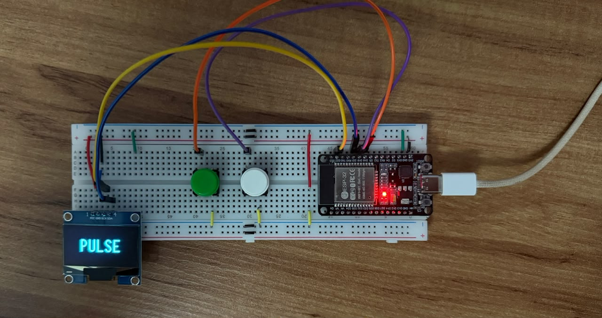
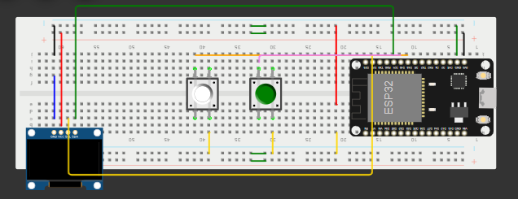

# Pulse firmware (ESP32)

A standalone version of Pulse: an ESP32 with two buttons and a small OLED screen. Press a button while a song is playing on Spotify (on any device), pick a playlist from the suggestions and the song is added. No computer involved.



## Hardware

| Part | Notes |
|---|---|
| ESP32 DevKit V1 (ESP32-WROOM-32) | 2.4 GHz Wi-Fi only |
| 1.3" OLED, SH1106, I2C | 128x64 |
| 2 push buttons | Navigate and Confirm |

| Signal | ESP32 pin |
|---|---|
| OLED SDA | GPIO 21 |
| OLED SCL | GPIO 22 |
| OLED VCC / GND | 3V3 / GND |
| Navigate button (green) | GPIO 18 → GND |
| Confirm button (white) | GPIO 19 → GND |



The buttons use the internal pull-ups (`INPUT_PULLUP`), so each one just goes between the pin and GND. Pins and timings are in [`include/config.h`](include/config.h).

## Setup

You need [PlatformIO](https://platformio.org/) and the same Spotify app used by the Python version.

1. In the Spotify app settings, add `http://127.0.0.1:8888/callback` as a Redirect URI.
2. Generate a refresh token (the ESP32 can't do the browser login itself):
   ```bash
   python tools/get_refresh_token.py
   ```
   It opens the browser, asks for the permissions Pulse needs (currently playing, read and modify playlists) and prints the token.
3. Copy `include/secrets.example.h` to `include/secrets.h` and fill in the Wi-Fi network, client ID and secret, the refresh token and, optionally, the fallback playlist ID and the Last.fm API key. `secrets.h` is in `.gitignore`.
4. Build and flash:
   ```bash
   cd firmware
   pio run -t upload
   pio device monitor      # serial log, 115200 baud
   ```

`pio run -e hwtest -t upload` flashes a small wiring test instead: each button lights the board LED, and the I2C lines are checked every 2 s (stuck low, missing pull-up, or the address of the display when found). Useful before soldering anything.

## Using it

| Screen | Navigate | Confirm |
|---|---|---|
| Idle (`PULSE`) | look up the current song | look up the current song; hold 3 s to re-sync all playlists |
| Suggestions | next option | add to the selected playlist |

The suggestion list shows the song and artist at the top and up to 5 playlists with the share of that artist in each one. Options that already contain the song are marked `já` ("already there"). `Fallback` and `Cancelar` are always in the list. With no input for 30 s the screen goes back to idle without adding anything.

If the artist isn't in any playlist, the suggestions come from Last.fm instead (top 3, marked with `~`). If that doesn't find anything either, all playlists are listed in alphabetical order.

Errors show for 3 s: no Wi-Fi, nothing playing, local file (not in the Spotify catalog, can't be added), API busy (rate limited) and `Reautorize` when the refresh token expired or was revoked (run `get_refresh_token.py` again).

## How it works

- **Boot.** Connects to Wi-Fi, gets an access token from the refresh token, reads the user and syncs the playlist profiles. Only playlists whose `snapshot_id` changed are re-read, so a normal boot takes about 10 s; the first one reads every playlist (~3,200 tracks in ~2.5 min).
- **Profiles.** One file per playlist on LittleFS with the main artist count of every track, the artist names (to match Last.fm results) and the track IDs (to detect duplicates). After adding a song the profile is updated locally with the new `snapshot_id`, so the next boot doesn't re-read it.
- **Ranking.** Direct match is the relative frequency of the artist in each playlist. It's simpler than the Python version (no TF-IDF or co-occurrence), which keeps it to one pass over the files. When there's no direct match, Last.fm `artist.getSimilar` is scored like the Python fallback: `sum(match * tf * idf)`, with an unsmoothed `tf`, so the numbers differ slightly.
- **State machine.** `IDLE → LOADING → SELECT → DONE / ERROR → IDLE`, in [`src/state_machine.cpp`](src/state_machine.cpp). Network calls are blocking and draw their own progress bar.

### Things that took a while

- **TLS validation.** The root CAs for `api.spotify.com`, `accounts.spotify.com` and `ws.audioscrobbler.com` are embedded in [`src/certs.h`](src/certs.h), so HTTPS is verified rather than `setInsecure()`.
- **Streaming JSON.** Responses are parsed straight from the socket with ArduinoJson filters, so a 40 KB Last.fm response becomes a few hundred bytes in RAM. This needs HTTP/1.0, because `HTTPClient::getStream()` doesn't decode chunked transfer encoding.
- **Hidden timeout.** `WiFiClientSecure` declares its own `_timeout` that shadows the one in `Stream`, so `HTTPClient::setTimeout()` never reached the reads done by ArduinoJson. Large responses were cut after 1 s with `IncompleteInput`.
- **Heap fragmentation.** Keeping hundreds of track IDs as `String`s while reading the largest playlist (640 tracks) left 100 KB free but no block bigger than 43 KB, and the TLS handshake for the next page failed. Track IDs now go straight to a temporary file during the sync.
- **Retries.** Failed connections and truncated responses are retried for `GET` only. A `POST` that times out may already have added the song, and retrying it would add it twice.
- **Refresh token rotation.** Spotify can return a new refresh token on refresh; it's saved to LittleFS and used instead of the one in `secrets.h` until `secrets.h` changes.

## Layout

```
include/config.h       pins, timings and limits
include/secrets.h      credentials (not versioned)
src/main.cpp           boot: Wi-Fi, login and sync
src/state_machine.*    screens and button handling
src/spotify_client.*   HTTPS, token refresh, 401/429 handling, retries
src/spotify_backend.*  current song, ranking and adding to a playlist
src/profiles.*         playlist profiles on LittleFS
src/lastfm.*           similar artists from Last.fm
src/display.*          OLED drawing (U8g2), scrolling text
src/buttons.*          debounce, click and hold
src/hwtest/            wiring test (separate env)
```
